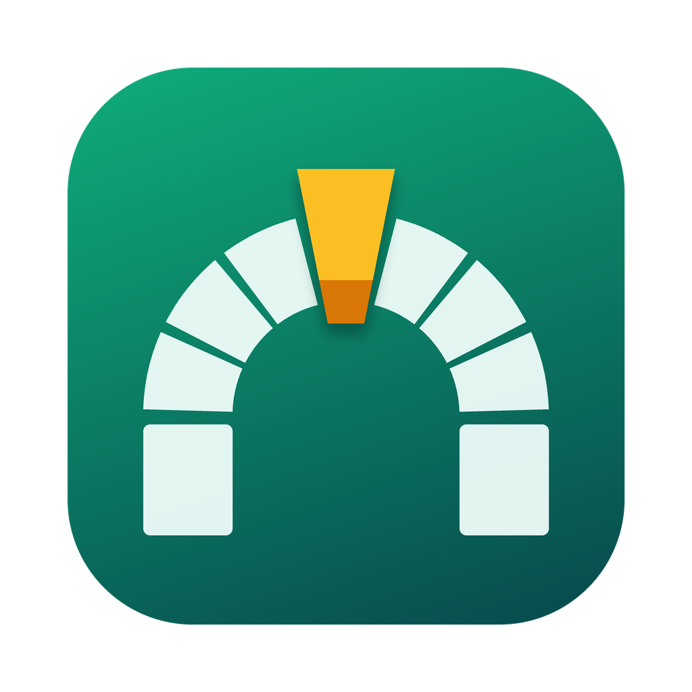

<p align="center">
  
</p>

<h1 align="center">Keystone</h1>

<p align="center">
  A desktop app that keeps a Swiss household in order: money, paperwork, to-dos, ideas and retirement provision, in one place.
</p>

---

Keystone runs on your Mac and keeps everything on your Mac. Your finances are stored in a local database, your
documents in your own OneDrive folder, and the optional AI that reads letters runs locally through
[Ollama](https://ollama.com). Nothing is sent to a cloud service.

The interface is available in English and German (Swiss spelling), and follows the Mac's language by default.

## Features

**Overview and runway**
- How long your money lasts ("your runway"), the day cash would run out and what causes it
- Daily income and spending, savings this financial year, and how long savings cover living costs
- A chart of cash over time with a projection, and the payments coming up in the next 30 days

**Transactions and debts**
- One-time, monthly, quarterly and yearly income and expenses, per household member or shared
- Debts with monthly repayment, repayment at once, or interest only, including extra repayments
- A year view by financial year, with any start month

**Documents**
- Bills, invoices, letters, notices, contracts, insurance policies, statements and payslips
- Filed in OneDrive as `Person / Year / Type / yyyy-MM-dd Title.pdf`, so the folder also makes sense in Finder
- Due dates and paid status for bills, with an option to add a bill to your expenses
- Drop one file to file it, or drop many at once to import them in bulk

**Local AI (optional, off by default)**
- Reads bills, statements and payslips and suggests income and expense entries
- Fills in a document's type, title, sender, date, amount, due date and the person it is for
- Reads pension fund certificates, 3a statements and AHV projections

**Tasks and notes**
- Tasks with due dates and a person, with overdue and upcoming tasks shown on the Overview
- Notes for projects and ideas that save as you type, grouped by project and pinnable

**Retirement provision (Swiss three pillars)**
- AHV, pension fund (BVG), vested benefits, pillar 3a and 3b accounts per person
- A history of the yearly letters: savings, growth, projected capital and pension at 65, possible buy-in
- Pillar 3a payments this year against the legal maximum, with a short guide to the Swiss rules

> The retirement figures and rules are a guide, not tax or financial advice. Your own letters and your canton's
> rules are what count.

## Requirements

- macOS on Apple Silicon (the packaging script also builds for Intel Macs)
- [.NET SDK 10.0.300](https://dotnet.microsoft.com/download) or later
- Optional, for the AI features: [Ollama](https://ollama.com) with the `qwen2.5vl:7b` model (about 6 GB)

## Getting started

Run the app from source:

```bash
dotnet run --project src/Runway
```

Debug builds use their own database (`runway-dev.db`), so trying things out never touches your real data.

Run the tests:

```bash
dotnet test
```

Build `Keystone.app` and install it in `/Applications`:

```bash
./scripts/package-mac.sh --install
```

The app is signed ad hoc, which is enough to run on the Mac that built it. It isn't notarized, so it isn't meant
to be shared with other Macs.

## Setting up the local AI

The AI features are off until you turn them on in **Settings → Local AI**.

The Ollama app is the fastest option on Apple Silicon, because it can use the GPU. Install it from
[ollama.com](https://ollama.com), then download the model:

```bash
ollama pull qwen2.5vl:7b
```

Alternatively, run Ollama in Docker. It runs on the CPU there, which is much slower.

```bash
docker compose up -d
docker compose exec ollama ollama pull qwen2.5vl:7b
```

Keystone talks to Ollama at `http://localhost:11434` by default. The address and the model can be changed in
Settings.

## Where your data lives

| What | Where |
| --- | --- |
| Database | `~/Library/Application Support/Runway/runway.db` |
| Documents | `~/OneDrive/PRAS/KeystoneApp`, changeable in Settings |
| Deleted documents | The `Deleted` folder inside the documents folder, so nothing is lost by accident |

Two environment variables override these locations, which is useful for testing:

| Variable | Effect |
| --- | --- |
| `RUNWAY_DB_PATH` | Use a different database file |
| `RUNWAY_ONEDRIVE_PATH` | Use a different folder as OneDrive |

## Project structure

```
src/Runway/
  Models/         Transactions, debts, people, documents, tasks, notes, retirement accounts
  Services/       Runway calculation, schedules, document filing, local AI, Swiss pension rules
  ViewModels/     MainViewModel, split by page (Documents, Tasks, Notes, Retirement, BulkImport)
  Views/          Avalonia XAML views and styles
  Localization/   English keys with German translations
  Data/           EF Core context, repository and migrations
tests/Runway.Tests/  xUnit tests
scripts/          App packaging and logo drawing
```

Built with [Avalonia](https://avaloniaui.net), [CommunityToolkit.Mvvm](https://github.com/CommunityToolkit/dotnet),
[EF Core](https://learn.microsoft.com/ef/core/) with SQLite, and [PdfPig](https://github.com/UglyToad/PdfPig).

The app was first called Runway. Its code, project and data folder still use that name; only what you see in the
app is called Keystone.

## Contributing

- Every text in the interface needs a German translation in `src/Runway/Localization/German.cs`. A test fails if
  one is missing.
- Changes to the data model need a migration:

  ```bash
  dotnet ef migrations add <Name> --project src/Runway --output-dir Data/Migrations
  ```

- The logo is drawn by `scripts/make-logo.py` (needs Pillow). Run it to regenerate `keystone.png` and `keystone.ico`.
