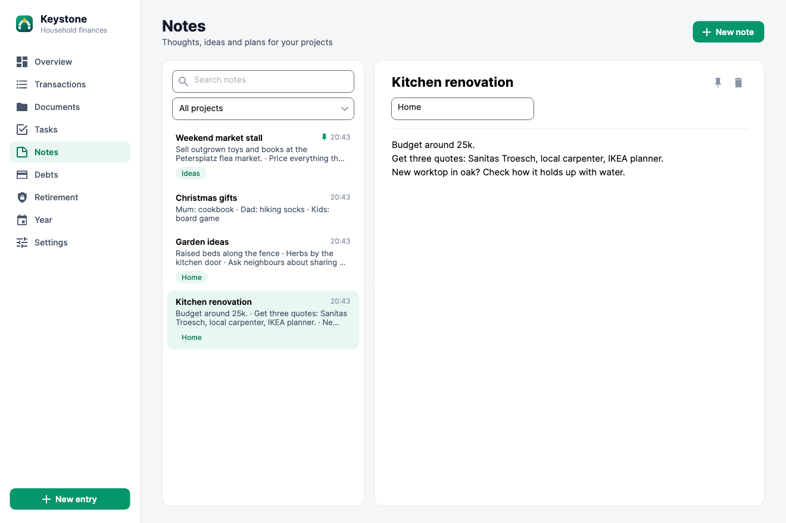

<p align="center">
  
</p>

<h1 align="center">Keystone</h1>

<p align="center">
  A desktop app that keeps a Swiss household in order: money, paperwork, to-dos, ideas and retirement provision, in one place.
</p>

---

Keystone runs on your Mac and keeps everything on your Mac. Your finances are stored in a local database, your
documents in your own OneDrive folder, and the optional AI that reads letters runs locally through
[Ollama](https://ollama.com). Nothing is sent to a cloud service.

The interface is available in English and German (Swiss spelling), and follows the Mac's language by default.


## Screenshots

The screenshots show a made-up family with sample data.

| | |
| --- | --- |
|  |  |
| **Transactions:** one-time and repeating income and expenses, per person | **Documents:** bills, letters and notices filed per person, with due dates |
|  |  |
| **Tasks:** what needs doing and by when | **Notes:** ideas and plans, grouped by project |
|  |  |
| **Retirement:** AHV, pension fund and pillar 3a, from the yearly letters | **German and dark mode** |

## Features

**Overview and runway**
- How long your money lasts ("your runway"), the day cash would run out and what causes it
- Daily income and spending, savings this financial year, and how long savings cover living costs
- A chart of cash over time with a projection, and the payments coming up in the next 30 days

**Transactions, accounts and debts**
- One-time, monthly, quarterly and yearly income and expenses, per household member or shared
- Several bank accounts, cards and cash, with transfers between them and an overdraft or credit limit
- Bank statement import: camt.053/054 files and CSV exports from Swiss banks, with categories suggested,
  entries you already have recognised, and the account set to the statement's closing balance
- Debts with monthly repayment, repayment at once, or interest only, including extra repayments
- A year view by financial year, with any start month

**Documents**
- Bills, invoices, letters, notices, contracts, insurance policies, statements and payslips
- Filed in OneDrive as `Person / Year / Type / yyyy-MM-dd Title.pdf`, so the folder also makes sense in Finder
- Due dates and paid status for bills, with an option to add a bill to your expenses
- Drop one file to file it, or drop many at once to import them in bulk
- Swiss QR-bills are read exactly: amount, payee, IBAN, reference and due date, with copy buttons for e-banking
- An inbox folder for phone scans (e.g. with the OneDrive app); Keystone offers to file whatever arrives
- Search inside PDFs and text files, and a guide to how long each kind of paper should be kept

**Local AI (optional, off by default)**
- Reads bills, statements and payslips and suggests income and expense entries
- Fills in a document's type, title, sender, date, amount, due date and the person it is for
- Reads pension fund certificates, 3a statements and AHV projections

**Tasks and notes**
- Tasks with due dates and a person, repeating weekly, monthly, quarterly or yearly if needed
- Notes for projects and ideas that save as you type, grouped by project and pinnable

**Insurance**
- Every policy with its premium, the end of its term and the last day to cancel it, e.g. 30 November for
  basic health insurance

**Contracts & dates**
- Contracts (mobile, internet, gym, leasing, rent…) with yearly cost and notice deadline
- Important dates such as passport and ID expiry, the car inspection (MFK), tyre changes and the vignette
- Warranties with their receipt and end date

**Planning**
- Savings goals, tracked by account or by hand, with the monthly amount needed
- What-if scenarios (working less, new costs, a big purchase) compared with today, without changing real entries
- The retirement gap: expected pensions and savings against what you'll need, and a plan for taking out pillar 3a
- Net worth over the last two years

**Taxes**
- A tax year's income, deductions (pillar 3a, pension fund buy-ins, childcare, medical costs, donations, debt
  interest) and assets on 31 December, plus a checklist of certificates to collect

**Everything else**
- Search across entries, documents, tasks, notes, insurance and accounts (⌘F)
- Reminders as macOS notifications for bills, tasks, notice deadlines, important dates, warranties and pillar 3a,
  even when Keystone is closed
- Daily backups of all data next to your documents in OneDrive, kept for 30 days, with restore
- App lock with Touch ID or your Mac password

**Retirement provision (Swiss three pillars)**
- AHV, pension fund (BVG), vested benefits, pillar 3a and 3b accounts per person
- A history of the yearly letters: savings, growth, projected capital and pension at 65, possible buy-in
- Pillar 3a payments this year against the legal maximum, with a short guide to the Swiss rules

> The retirement figures and rules are a guide, not tax or financial advice. Your own letters and your canton's
> rules are what count.

## Requirements

- macOS on Apple Silicon (the packaging script also builds for Intel Macs)
- [.NET SDK 10.0.300](https://dotnet.microsoft.com/download) or later
- Optional, for the AI features: [Ollama](https://ollama.com) with the `qwen2.5vl:7b` model (about 6 GB)

## Getting started

Run the app from source:

```bash
dotnet run --project src/Keystone
```

Debug builds use their own database (`keystone-dev.db`), so trying things out never touches your real data.

Run the tests:

```bash
dotnet test
```

Build `Keystone.app` and install it in `/Applications`:

```bash
./scripts/package-mac.sh --install
```

The app is signed ad hoc, which is enough to run on the Mac that built it. It isn't notarized, so it isn't meant
to be shared with other Macs.

## Setting up the local AI

The AI features are off until you turn them on in **Settings → Local AI**.

The Ollama app is the fastest option on Apple Silicon, because it can use the GPU. Install it from
[ollama.com](https://ollama.com), then download the model:

```bash
ollama pull qwen2.5vl:7b
```

Alternatively, run Ollama in Docker. It runs on the CPU there, which is much slower.

```bash
docker compose up -d
docker compose exec ollama ollama pull qwen2.5vl:7b
```

Keystone talks to Ollama at `http://localhost:11434` by default. The address and the model can be changed in
Settings.

## Where your data lives

| What | Where |
| --- | --- |
| Database | `~/Library/Application Support/Keystone/keystone.db` |
| Documents | `~/OneDrive/PRAS/KeystoneApp`, changeable in Settings |
| Deleted documents | The `Deleted` folder inside the documents folder, so nothing is lost by accident |

Two environment variables override these locations, which is useful for testing:

| Variable | Effect |
| --- | --- |
| `KEYSTONE_DB_PATH` | Use a different database file |
| `KEYSTONE_ONEDRIVE_PATH` | Use a different folder as OneDrive |

## Project structure

```
src/Keystone/
  Models/         Transactions, debts, people, documents, tasks, notes, retirement accounts
  Services/       Runway calculation, schedules, document filing, local AI, Swiss pension rules
  ViewModels/     MainViewModel, split by page (Documents, Tasks, Notes, Retirement, BulkImport)
  Views/          Avalonia XAML views and styles
  Localization/   English keys with German translations
  Data/           EF Core context, repository and migrations
tests/Keystone.Tests/  xUnit tests
scripts/          App packaging and logo drawing
```

Built with [Avalonia](https://avaloniaui.net), [CommunityToolkit.Mvvm](https://github.com/CommunityToolkit/dotnet),
[EF Core](https://learn.microsoft.com/ef/core/) with SQLite, and [PdfPig](https://github.com/UglyToad/PdfPig).

The app was first called Runway. On its first start, Keystone moves data from that time to the new places: the
database from `Application Support/Runway` and the documents folder from `OneDrive/PRAS/RunwayApp`. "Your runway"
is still the name of the Overview's headline figure: how long your money lasts.

## Contributing

- Every text in the interface needs a German translation in `src/Keystone/Localization/German.cs`. A test fails if
  one is missing.
- Changes to the data model need a migration:

  ```bash
  dotnet ef migrations add <Name> --project src/Keystone --output-dir Data/Migrations
  ```

- The logo is drawn by `scripts/make-logo.py` (needs Pillow). Run it to regenerate `keystone.png` and `keystone.ico`.
