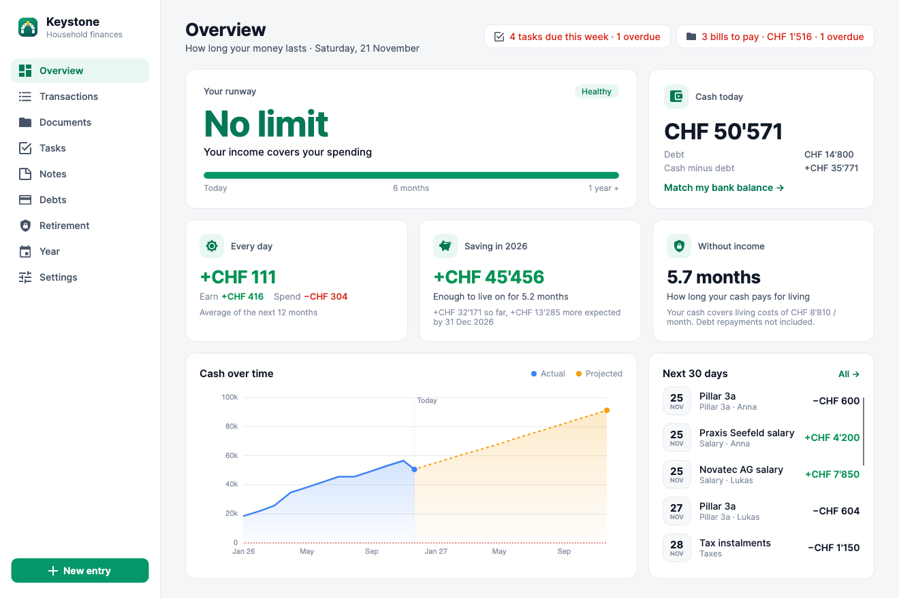
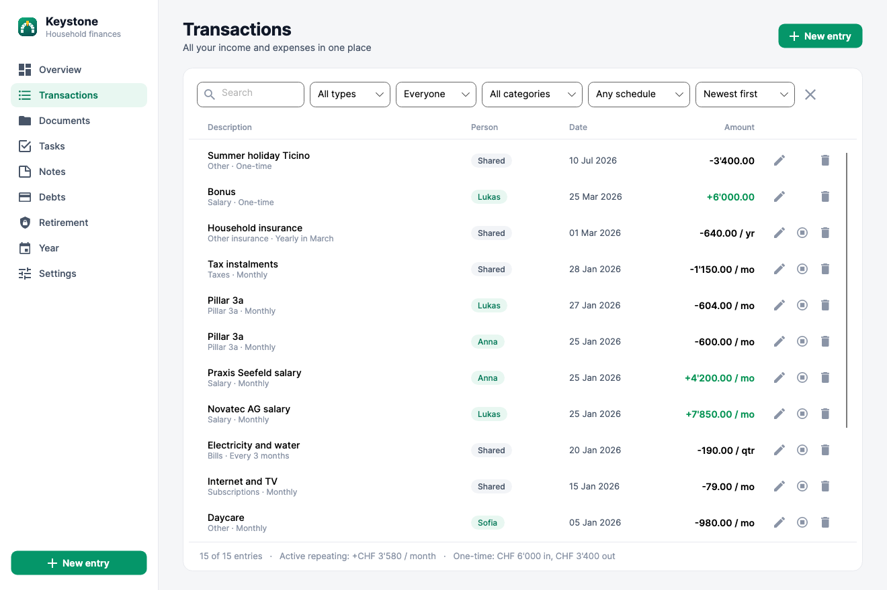
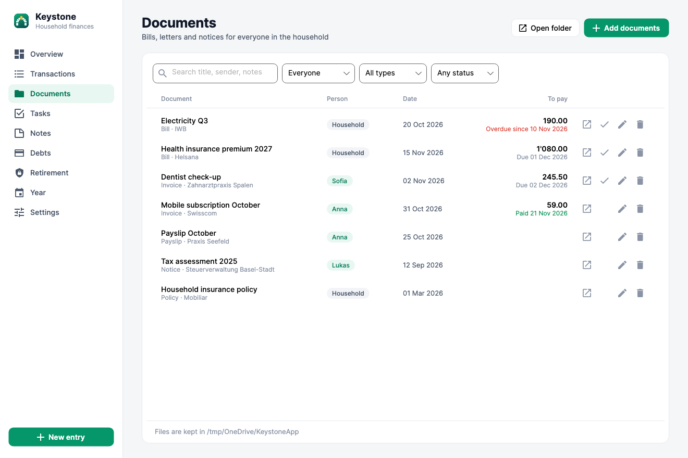
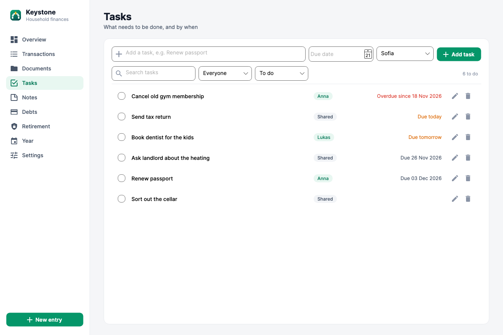
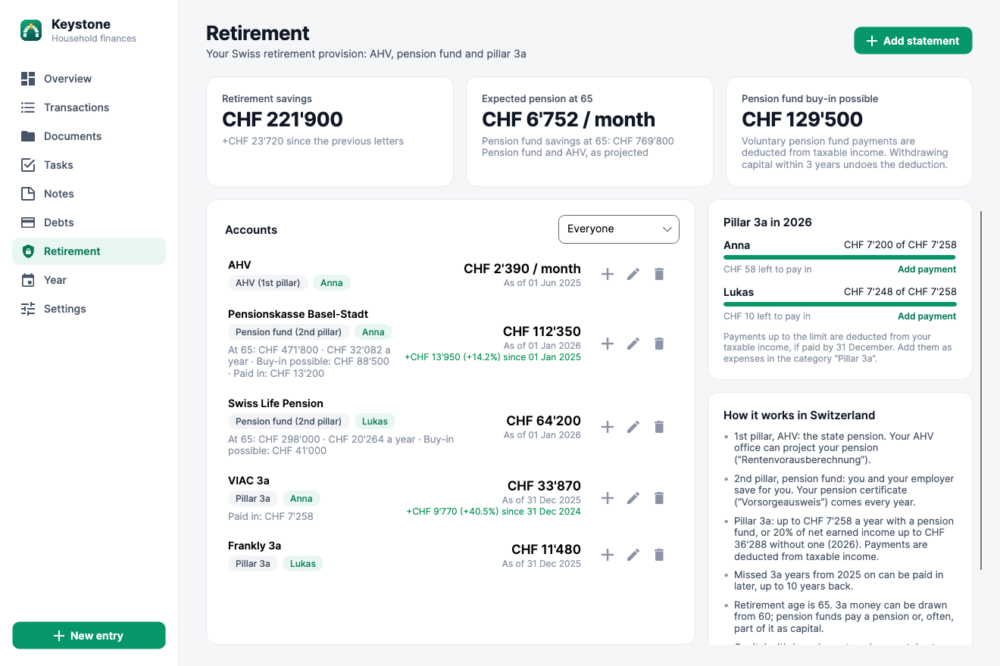
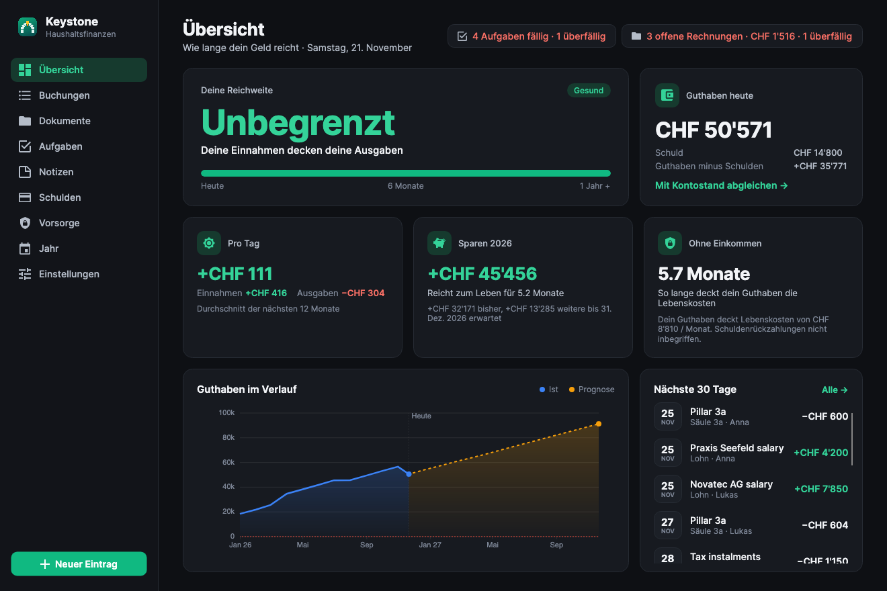

<p align="center">
  
</p>

<h1 align="center">Keystone</h1>

<p align="center">
  A desktop app that keeps a Swiss household in order: money, paperwork, to-dos, ideas and retirement provision, in one place.
</p>

---

Keystone runs on your Mac and keeps everything on your Mac. Your finances are stored in a local database, your
documents in your own OneDrive folder, and the optional AI that reads letters runs locally through
[Ollama](https://ollama.com). Nothing is sent to a cloud service.

The interface is available in English and German (Swiss spelling), and follows the Mac's language by default.



## Screenshots

The screenshots show a made-up family with sample data.

| | |
| --- | --- |
|  |  |
| **Transactions:** one-time and repeating income and expenses, per person | **Documents:** bills, letters and notices filed per person, with due dates |
|  |  |
| **Tasks:** what needs doing and by when | **Notes:** ideas and plans, grouped by project |
|  |  |
| **Retirement:** AHV, pension fund and pillar 3a, from the yearly letters | **German and dark mode** |

## Features

**Finding your way**
- The sidebar has three groups: Money, Paperwork and Home. Pages that belong together are tabs of one place
  (entries and the year; debts, assets and net worth; retirement accounts and the plan for 65; tasks and appointments)
- One **+ New** button (⌘N) adds anything from anywhere: an entry, a bill, a task, a medicine, a contract…
- Pick a person in the sidebar to see only their things on every page
- Forms show the fields most things need; the rest are under "More details"
- Settings are in tabs

**Overview**
- This week at a glance: seven days with appointments, tasks, bills and payments, deadlines and medicines running out
- "Needs your attention": overdue bills, tasks due, today's appointments, notice deadlines, expiring documents
  and warranties, medicines, sick days and scans waiting in the inbox, each with a button to deal with it; choose
  which kinds show
- Money at a glance: cash today, how long your money lasts (as a date), this month in and out, and savings
  this financial year
- Coming up in the next three weeks: payments, bills, appointments and deadlines in one list
- A chart of cash over time with a projection; every section can be moved and folded

**Transactions, accounts and debts**
- One-time, monthly, quarterly and yearly income and expenses, per household member or shared
- Separate tabs for income, one-time expenses, recurring expenses (with what they cost a month and a year) and transfers
- Change a single time of a repeating entry (a 13th salary, a bonus, a smaller paycheck) or skip it once
- Several bank accounts, cards and cash, with transfers between them and an overdraft or credit limit
- Bank statement import: camt.053/054 files and CSV exports from Swiss banks, with categories suggested,
  entries you already have recognised, and the account set to the statement's closing balance
- Debts with monthly repayment, repayment at once, or interest only, including extra repayments,
  borrowing more from the same lender, and corrections to amounts and dates
- A year view by financial year, with any start month
- Export the entries or every booking of a year as CSV (for Excel or Numbers), or the year as a one-page PDF
- Undo after deleting an entry or a debt
- A desktop widget (small, medium, large) with open tasks, bills to pay and the next appointments

**Documents**
- Bills, invoices, letters, notices, contracts, insurance policies, statements and payslips
- Filed in OneDrive as `Person / Year / Type / yyyy-MM-dd Title.pdf`, so the folder also makes sense in Finder
- Due dates and paid status for bills, with an option to add a bill to your expenses
- Pay a big bill (taxes, for example) in instalments: choose how many and how often, change any part, tick each one off as you pay it; every part is reminded and counted in your expenses on its own date
- Drop one file to file it, or drop many at once to import them in bulk
- Swiss QR-bills are read exactly: amount, payee, IBAN, reference and due date, with copy buttons for e-banking
- An inbox folder for phone scans (e.g. with the OneDrive app); Keystone offers to file whatever arrives
- Filing the same paper twice is noticed (the same file, the same QR-bill, or same sender, amount and date)
- A filed insurance policy or premium letter is saved under Insurance by itself: the policy is added or updated,
  its premium goes into your expenses (a new premium replaces the old one from the new term), and the paper is
  listed with your insurance papers. One click undoes it
- "Check filed papers" on the Insurance page does the same for insurance papers you filed earlier
- A filed contract, passport or purchase receipt is offered for Contracts & dates, filled in from the document,
  so its notice deadline or expiry gets a reminder
- Search inside PDFs, text files, scans and photos (scans are read on the Mac with macOS text recognition),
  and a guide to how long each kind of paper should be kept

**Local AI (optional, off by default)**
- Reads bills, statements and payslips and suggests income and expense entries
- Fills in a document's type, title, sender, date, amount, due date and the person it is for
- Reads pension fund certificates, 3a statements and AHV projections

**Appointments and calendar**
- Appointments with a time or all day, a place, notes, a person and a reminder
- Two-way sync with a calendar in the Mac's Calendar app (iCloud, Google, Exchange…): what you add or change in
  either place shows in the other, so appointments also reach your iPhone
- Choose an existing calendar or let Keystone add a "Keystone" calendar of its own

**Tasks and notes**
- Tasks with due dates and a person, repeating weekly, monthly, quarterly or yearly if needed
- Notes for projects and ideas that save as you type, grouped by project and pinnable

**Household**
- A profile for each member: date of birth, phone, email and AHV number, with copy buttons
- Health basics for the doctor or an emergency: allergies, conditions, blood type, family doctor and whom to call,
  copied as text in one click (e.g. for a babysitter or a new doctor)
- Medicines and pills per person: how much and when (morning, noon, evening, night or when needed), courses with a
  last day, and with the number on hand, the day they run out; a reminder before that and before a prescription ends,
  and one click when a new pack arrives
- Jobs with the manager's and HR's numbers and how they want to hear when you're ill: by phone, email, text or the
  staff portal, before what time, and from which day a doctor's certificate is needed
- "Ill today" (or "Accident") lists what to do in order, ticks off what's done, reminds you when the certificate is
  due and copies a short message to work; sick days are counted per year
- Without a sick pay insurer, the legal minimum of sick pay for the year of service (Bern scale), as a guide

**Insurance**
- Every policy with its premium, the end of its term and the last day to cancel it, e.g. 30 November for
  basic health insurance
- "Your cover": the insurances common in Switzerland (basic health for each person, liability, household contents,
  car, building, accident, legal protection and more), which ones you have, the gaps, and which don't apply to you
- Open bills from your insurers in one place; tax bills likewise on the Taxes page
- The latest insurance and tax papers, with a link to all of them under Documents
- Health costs per year and person: health insurance premiums plus the cost-sharing bills (Leistungsabrechnungen)
  from your health insurer, and with your deductible entered, how much more can still be billed this year

**Contracts & dates**
- Contracts (mobile, internet, gym, leasing, rent…) with yearly cost and notice deadline
- All notice deadlines of the next 12 months in one list, contracts and insurance policies together
- Important dates such as passport and ID expiry, the car inspection (MFK), tyre changes and the vignette
- Warranties with their receipt and end date

**Planning**
- Savings goals, tracked by account or by hand, with the monthly amount needed
- What-if scenarios (working less, new costs, a big purchase) compared with today, without changing real entries
- The retirement gap: expected pensions and savings against what you'll need, and a plan for taking out pillar 3a
- Net worth over the last two years

**Taxes**
- A tax year's income, deductions (pillar 3a, pension fund buy-ins, childcare, medical costs, donations, debt
  interest) and assets on 31 December, plus a checklist of certificates to collect
- A rough tax estimate from your own rate (last year's tax, or a rate you set) and whether your instalments
  are enough

**Everything else**
- Search across entries, documents, tasks, appointments, notes, insurance and accounts (⌘F)
- Reminders as macOS notifications for bills, tasks, appointments, notice deadlines, important dates, warranties, medicines,
  doctor's certificates and pillar 3a,
  even when Keystone is closed
- Daily backups of all data next to your documents in OneDrive, kept for 30 days, with restore
- App lock with Touch ID or your Mac password; it locks when your Mac locks, not every time you switch apps

**Assets**
- Securities accounts, crypto, property, vehicles and other things of value, with their value over time
- Counted in your net worth, and listed with the assets for the tax return on 31 December

**Retirement provision (Swiss three pillars)**
- AHV, pension fund (BVG), vested benefits, pillar 3a and 3b accounts per person
- A history of the yearly letters: savings, growth, projected capital and pension at 65, possible buy-in
- Pillar 3a payments this year against the legal maximum, with a short guide to the Swiss rules

> The retirement figures and rules are a guide, not tax or financial advice. Your own letters and your canton's
> rules are what count.

## Requirements

- macOS on Apple Silicon (the packaging script also builds for Intel Macs)
- [.NET SDK 10.0.300](https://dotnet.microsoft.com/download) or later
- Optional, for the AI features: [Ollama](https://ollama.com) with the `qwen2.5vl:7b` model (about 6 GB)

## Getting started

Run the app from source:

```bash
dotnet run --project src/Keystone
```

Debug builds use their own database (`keystone-dev.db`), so trying things out never touches your real data.

Run the tests:

```bash
dotnet test
```

Build `Keystone.app` and install it in `/Applications`:

```bash
./scripts/package-mac.sh --install
```

The app is signed ad hoc, which is enough to run on the Mac that built it. It isn't notarized, so it isn't meant
to be shared with other Macs.

## Setting up the local AI

The AI features are off until you turn them on in **Settings → Local AI**.

The Ollama app is the fastest option on Apple Silicon, because it can use the GPU. Install it from
[ollama.com](https://ollama.com), then download the model:

```bash
ollama pull qwen2.5vl:7b
```

Alternatively, run Ollama in Docker. It runs on the CPU there, which is much slower.

```bash
docker compose up -d
docker compose exec ollama ollama pull qwen2.5vl:7b
```

Keystone talks to Ollama at `http://localhost:11434` by default. The address and the model can be changed in
Settings.

## Where your data lives

| What | Where |
| --- | --- |
| Database | `~/Library/Application Support/Keystone/keystone.db` |
| Documents | `~/OneDrive/PRAS/KeystoneApp`, changeable in Settings |
| Deleted documents | The `Deleted` folder inside the documents folder, so nothing is lost by accident |

Two environment variables override these locations, which is useful for testing:

| Variable | Effect |
| --- | --- |
| `KEYSTONE_DB_PATH` | Use a different database file |
| `KEYSTONE_ONEDRIVE_PATH` | Use a different folder as OneDrive |

## Project structure

```
src/Keystone/
  Models/         Transactions, debts, people, documents, tasks, notes, retirement accounts
  Services/       Runway calculation, schedules, document filing, local AI, Swiss pension rules
  ViewModels/     MainViewModel for money and paperwork, plus one view model per area (Tasks, Notes, Retirement…)
  Views/          The window, one file per page and form (Views/Pages), styles
  Localization/   English keys with German translations
  Data/           EF Core context, repository and migrations
tests/Keystone.Tests/  xUnit tests
scripts/          App packaging and logo drawing
```

Built with [Avalonia](https://avaloniaui.net), [CommunityToolkit.Mvvm](https://github.com/CommunityToolkit/dotnet),
[EF Core](https://learn.microsoft.com/ef/core/) with SQLite, and [PdfPig](https://github.com/UglyToad/PdfPig).

The app was first called Runway. On its first start, Keystone moves data from that time to the new places: the
database from `Application Support/Runway` and the documents folder from `OneDrive/PRAS/RunwayApp`. "Runway"
survives in the code for how long your money lasts.

## Contributing

- Every text in the interface needs a German translation in `src/Keystone/Localization/German.cs`. A test fails if
  one is missing.
- Changes to the data model need a migration:

  ```bash
  dotnet ef migrations add <Name> --project src/Keystone --output-dir Data/Migrations
  ```

- The logo is drawn by `scripts/make-logo.py` (needs Pillow). Run it to regenerate `keystone.png` and `keystone.ico`.
